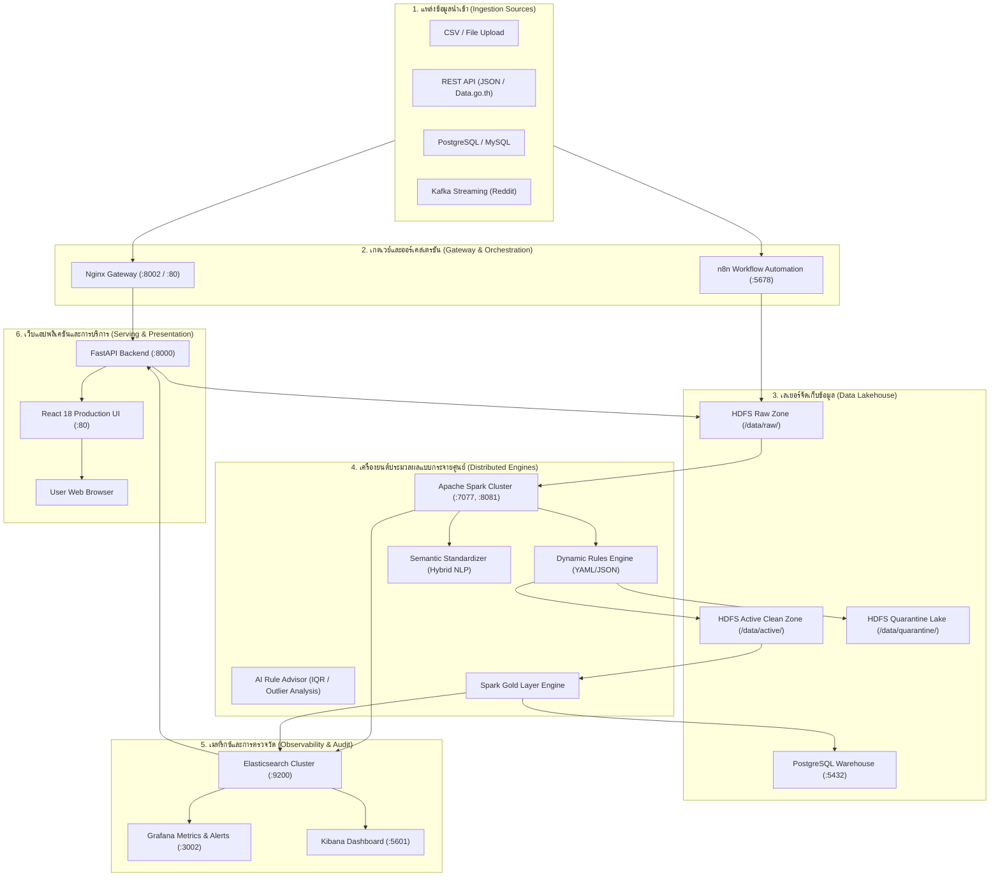

# SDOQAP - Scalable Data Observability and Quality Assurance Platform

[](#สถาปัตยกรรมระบบแบบ-white-box-architecture)
[](#step-3-ประมวลผลและคัดแยกข้อมูล-3-ทาง-spark-execution--3-way-segregation)
[](#step-3-ประมวลผลและคัดแยกข้อมูล-3-ทาง-spark-execution--3-way-segregation)
[](#service-endpoints-catalog)
[](LICENSE)

**SDOQAP (Scalable Data Observability and Quality Assurance Platform)** คือแพลตฟอร์มวิศวกรรมข้อมูลแบบครบวงจร (End-to-End White-Box Data Engineering Platform) ที่ออกแบบมาเพื่อแก้ไขปัญหา **"กล่องดำ (Black Box)"** ของระบบ ETL ดั้งเดิม โดยเปิดเผยกระบวนการคัดกรอง การให้เหตุผลทางสถิติ (Statistical Reasoning) การคัดแยกข้อมูล 3 โซน (Clean, Review Queue, Quarantine) การแจ้งเตือนแก้ไขข้อมูลที่ต้นทาง (Upstream-First Remediation) ตลอดจนการส่งมอบข้อมูลคุณภาพสูงไปใช้ประโยชน์จริงครบทั้ง 4 ระดับ (Data Engineer, Academic Faculty, Executive, และ Business Analyst)

---

## สารบัญ (Table of Contents)

1. [สถาปัตยกรรมระบบแบบ White-Box (Architecture)](#สถาปัตยกรรมระบบแบบ-white-box-architecture)
2. [ข้อกำหนดเบื้องต้นและการเตรียมความพร้อม (Prerequisites)](#ข้อกำหนดเบื้องต้นและการเตรียมความพร้อม-prerequisites)
3. [การเริ่มต้นระบบแบบ One-Click (Quickstart)](#การเริ่มต้นระบบแบบ-one-click-quickstart)
4. [Service Endpoints Catalog](#service-endpoints-catalog)
5. [คู่มือการใช้งานระบบตั้งแต่ต้นจนจบ (End-to-End System Walkthrough)](#คู่มือการใช้งานระบบตั้งแต่ต้นจนจบ-end-to-end-system-walkthrough)
   - [Step 1: การนำเข้าข้อมูลและสำรวจสถิติ (Ingestion & Profiling)](#step-1-การนำเข้าข้อมูลและสำรวจสถิติ-ingestion--profiling)
   - [Step 2: การกำหนดกฎและการปรับมาตรฐานข้อมูล (Expectations & Governance)](#step-2-การกำหนดกฎและการปรับมาตรฐานข้อมูล-expectations--governance)
   - [Step 3: ประมวลผลและคัดแยกข้อมูล 3 ทาง (Spark Execution & 3-Way Segregation)](#step-3-ประมวลผลและคัดแยกข้อมูล-3-ทาง-spark-execution--3-way-segregation)
   - [Step 4: การแก้ไขข้อมูลที่ระบบต้นทาง (Upstream Closed-Loop Remediation)](#step-4-การแก้ไขข้อมูลที่ระบบต้นทาง-upstream-closed-loop-remediation)
   - [Step 5: การนำข้อมูลไปใช้ประโยชน์จริง 4 มิติ (Data Utilization Spectrum)](#step-5-การนำข้อมูลไปใช้ประโยชน์จริง-4-มิติ-data-utilization-spectrum)
   - [Step 6: การส่งออกข้อมูลและระบบตรวจสอบความน่าเชื่อถือ (Export & Trust-Check API)](#step-6-การส่งออกข้อมูลและระบบตรวจสอบความน่าเชื่อถือ-export--trust-check-api)
6. [การทดสอบระบบผ่าน CLI และสคริปต์อัตโนมัติ (Automated Testing & Benchmarks)](#การทดสอบระบบผ่าน-cli-และสคริปต์อัตโนมัติ-automated-testing--benchmarks)
7. [การตั้งค่า Environment Variables](#การตั้งค่า-environment-variables)
8. [การตรวจสอบและบำรุงรักษาระบบ (Monitoring & Maintenance)](#การตรวจสอบและบำรุงรักษาระบบ-monitoring--maintenance)
9. [โครงสร้างไฟล์และโมดูล (Project Structure)](#โครงสร้างไฟล์และโมดูล-project-structure)

---

## สถาปัตยกรรมระบบแบบ White-Box (Architecture)

SDOQAP ทำงานบนระบบ Containerized Microservices โดยมีกระบวนการไหลของข้อมูลที่โปร่งใสในทุกขั้นตอน:



---

## ข้อกำหนดเบื้องต้นและการเตรียมความพร้อม (Prerequisites)

1. **ระบบปฏิบัติการ:** Windows 10/11 (แนะนำรันร่วมกับ WSL2) หรือ Linux / macOS
2. **โปรแกรมที่จำเป็น:**
   - **Docker Desktop** (เปิดใช้งาน WSL 2 engine และเปิด Docker daemon เรียบร้อย)
   - **Python 3.10+** (สำหรับรันสคริปต์ทดสอบและ Integration tests)
   - **Git**
3. **ทรัพยากรเครื่องที่แนะนำ:**
   - RAM: อย่างน้อย 8 GB (โหมดเต็มแนะนำ 16 GB)
   - พื้นที่ว่างบนดิสก์: อย่างน้อย 15 GB

### การสร้างไฟล์คอนฟิก `.env`

ก่อนเริ่มระบบ ให้ตรวจสอบไฟล์ `.env` ในโฟลเดอร์หลัก หากยังไม่มี ให้คัดลอกจาก `.env.example`:

```bash
copy .env.example .env
```

ตัวอย่างค่าคอนฟิกสำคัญใน `.env`:
```ini
ELASTICSEARCH_USER=elastic
ELASTICSEARCH_PASSWORD=sdoqap_secure
ELASTICSEARCH_HOST=elasticsearch
ELASTICSEARCH_PORT=9200
HDFS_URL=hdfs://namenode:9000

ADMIN_USERNAME=admin
ADMIN_PASSWORD=change-me-to-a-strong-password
SESSION_SECRET_KEY=e3b0c44298fc1c149afbf4c8996fb92427ae41e4649b934ca495991b7852b855
SESSION_COOKIE_SECURE=false

# ควบคุมโมดูลที่ต้องการเปิด (โหมดประหยัด RAM สามารถเว้นว่างได้)
COMPOSE_PROFILES=streaming,ai,tools
```

> **โหมดเบา (Lightweight Mode):** หากมี RAM จำกัด (เช่น 8 GB) สามารถตั้งค่า `COMPOSE_PROFILES=` (ปล่อยว่าง) ซึ่งจะปิดการทำงานของ Kafka, Zookeeper, Ollama และ pgAdmin ช่วยประหยัด RAM ได้ราว 6.9 GB โดยระบบประมวลผลหลัก (Spark, HDFS, Elasticsearch, API, React UI) ยังทำงานได้ครบ 100%

---

## การเริ่มต้นระบบแบบ One-Click (Quickstart)

คุณสามารถเปิดและทดสอบระบบได้ทันทีผ่านสคริปต์ 2 ตัวที่หน้าโฟลเดอร์หลัก:

```cmd
start_system.bat
test_data_source.bat
```

### ขั้นตอนที่ 1: เปิดระบบทั้งหมด

รันคำสั่ง:
```cmd
start_system.bat
```
สคริปต์จะตรวจสอบความพร้อมของ Docker, ดึง Image, รัน Container ทั้งหมด, รอให้ HDFS และ Elasticsearch พร้อมใช้งาน จากนั้นจะเปิด Web Browser ไปยังหน้า Central Portal โดยอัตโนมัติ

### ขั้นตอนที่ 2: รันการทดสอบข้อมูล

เปิดหน้าต่างเทอร์มินัลใหม่ แล้วรัน:
```cmd
test_data_source.bat
```
ระบบจะแสดงเมนูสำหรับการทดสอบข้อมูลดิบเข้าสู่ Pipeline ทันที:
```text
=======================================================================
  Select Test Source
=======================================================================
  1. Test with local CSV dataset
  2. Test with API URL
  3. Test with Reddit Live Stream
  4. Open Central Portal
  5. Show HDFS raw datasets
  6. Exit
=======================================================================
```

---

## Service Endpoints Catalog

เมื่อระบบเปิดทำงานสมบูรณ์ สามารถเข้าถึงเซอร์วิสต่างๆ ได้ผ่านพอร์ตต่อไปนี้:

| บริการ (Service) | URL | ข้อมูลการเข้าสู่ระบบ (Credentials) | บทบาทหน้าที่ |
| :--- | :--- | :--- | :--- |
| **Central Web Portal** | [`http://localhost:8002/`](http://localhost:8002/) | `admin` / ตามที่ระบุใน `.env` | หน้าเว็บกลาง Databricks-style สำหรับจัดการ Pipeline, กฎ และแดชบอร์ด |
| **FastAPI Swagger Docs**| [`http://localhost:8002/docs`](http://localhost:8002/docs) | - | เอกสาร REST API และการทดสอบ Endpoint เชิงเทคนิค |
| **Grafana Observability**| [`http://localhost:3002/`](http://localhost:3002/) | `admin` / `admin` | แดชบอร์ดตรวจสอบสุขภาพระบบ เมทริกซ์ Throughput และ SLA |
| **n8n Workflow Engine** | [`http://localhost:5678/`](http://localhost:5678/) | Setup ตอนเปิดครั้งแรก | ระบบ Orchestration สำหรับดึงข้อมูลและส่ง Webhook แจ้งเตือน |
| **HDFS NameNode UI** | [`http://localhost:9870/`](http://localhost:9870/) | - | สำรวจ Data Lake ในระดับโซนดิบ, โซนสะอาด และโซนกักกัน |
| **Spark Master UI** | [`http://localhost:8081/`](http://localhost:8081/) | - | ตรวจสอบสถานะคลัสเตอร์ Spark, Workers, และประวัติการรัน Job |
| **Elasticsearch API** | [`http://localhost:9200/`](http://localhost:9200/) | Basic Auth: `elastic` / `sdoqap_secure` | เมทาดาต้าสโตร์สำหรับจัดเก็บคะแนน ผลตรวจคุณภาพ และดัชนีการสืบค้น |
| **Kibana Portal** | [`http://localhost:5601/`](http://localhost:5601/) | เข้าผ่าน Elasticsearch Credential | เครื่องมือสำรวจ Audit Logs และวิเคราะห์ประวัติดัชนี |

---

## คู่มือการใช้งานระบบตั้งแต่ต้นจนจบ (End-to-End System Walkthrough)

ระบบถูกออกแบบให้ทำงานสอดคล้องกับแนวคิด **White-Box Semi-Automated Data Engineering** ผ่าน 6 ขั้นตอนหลัก:

```text
[1. Ingestion & Profiling]
         │
         ▼
[2. Expectations & Governance] ◄── AI Rule Advisor & Hybrid Semantic Mapping
         │
         ▼
[3. Spark 3-Way Segregation] ──► 🟢 Active Clean Lake
         │                  ──► 🟡 Review Queue
         │                  ──► 🔴 Quarantine Lake
         ▼
[4. Closed-Loop Remediation] ──► Upstream Tickets & Root-Cause Feedback
         │
         ▼
[5. 4-Tier Data Utilization] ──► 1. Technical Cockpit (Data Engineer)
         │                  ──► 2. Academic Support (Faculty)
         │                  ──► 3. Executive Overview (C-Level)
         │                  ──► 4. AI Self-Service BI (Analyst)
         ▼
[6. Workspace Export & Trust] ──► Lineage Trust-Check API (Pre-consumption gate)
```

---

### Step 1: การนำเข้าข้อมูลและสำรวจสถิติ (Ingestion & Profiling)

**URL ในระบบ:** [`http://localhost:8002/ingestion`](http://localhost:8002/ingestion)

SDOQAP รองรับการนำเข้าข้อมูล 4 รูปแบบ:
1. **File Upload (CSV / Parquet):** ลากและวางไฟล์ลงในหน้าเว็บ หรือวางไฟล์ไว้ในโฟลเดอร์ `data/inputs/datasets/`
2. **REST API Ingestion:** รองรับการดึงข้อมูลจาก Endpoint ภายนอก (เช่น ข้อมูลภาครัฐ `data.go.th`) พร้อมระบบตรวจสอบความปลอดภัย SSRF Domain Allowlist
3. **RDBMS Connection:** เชื่อมต่อและดึงข้อมูลจากตารางใน PostgreSQL หรือ MySQL โดยใช้สิทธิ์ Read-Only เพื่อป้องกันความเสี่ยงด้านความปลอดภัย
4. **Kafka Real-time Stream:** สตรีมข้อความสดจาก Kafka Topics (เช่น Reddit Stream)

**การทำความเข้าใจสถิติ (Data Profiling):**
ทันทีที่นำเข้าข้อมูล ระบบจะคำนวณและแสดงผลสถิติ 6 มิติทันทีโดยไม่ต้องรันคำสั่งเพิ่ม:
- **Row Count:** ปริมาณข้อมูลทั้งหมด
- **Null Rate (%):** สัดส่วนค่าว่างแยกรายคอลัมน์
- **Cardinality:** จำนวนค่าที่ไม่ซ้ำกัน
- **Min / Max:** ขอบเขตของค่าตัวเลขและวันที่
- **Duplicate Rows:** จำนวนแถวที่ซ้ำซ้อนกันทั้งแถว
- **Outlier Detection:** ตรวจจับค่าผิดปกติด้วยสถิติ Interquartile Range (IQR)

---

### Step 2: การกำหนดกฎและการปรับมาตรฐานข้อมูล (Expectations & Governance)

**URL ในระบบ:** [`http://localhost:8002/rules`](http://localhost:8002/rules)

#### 1. การกำหนดกฎคุณภาพข้อมูล (Dynamic Rules)
กฎถูกเก็บในรูปแบบ YAML DSL และ JSON (`services/spark/rules_config.json`) โดยไม่ต้องคอมไพล์โค้ดใหม่:
- `expect_column_values_to_not_be_null`: ห้ามมีค่าว่าง (เช่น Primary Key: `student_id`)
- `expect_column_values_to_be_between`: ตรวจสอบขอบเขตตัวเลข (เช่น คะแนน `0 - 100`)
- `expect_column_values_to_match_regex`: รูปแบบข้อความ (เช่น รหัสนักศึกษา 8 หลัก)
- `expect_column_values_to_be_in_set`: ค่าที่อนุญาตในหมวดหมู่
- **Severity Classification:**
  - `CRITICAL`: ตกเกณฑ์นี้ แถวจะถูกส่งเข้า Quarantine ทันที
  - `WARNING`: บันทึกคำเตือนใน Audit Log แต่อนุญาตให้ประมวลผลต่อได้

#### 2. คำแนะนำกฎอัจฉริยะ (AI Rule Advisor)
ระบบคำนวณสถิติ $IQR = Q_3 - Q_1$ และกำหนดขอบเขตที่ไม่รวม Outlier $[Q_1 - 1.5 \times IQR, Q_3 + 1.5 \times IQR]$ พร้อมอธิบายเหตุผล "Why?" ให้วิศวกรกดยอมรับ (`Accept`) เข้าสู่ระบบได้ทันที

#### 3. การจัดการคำศัพท์หลากหลาย (Semantic Standardization)
แก้ปัญหาคำสะกดผิด คำพ้อง และตัวย่อ (เช่น `คณิต 1`, `Math I`, `คนิตศาสตร์`) ผ่าน **3-Tier Mapping**:
- **Tier 1 (Memory Hash Match):** ตรวจสอบจากพจนานุกรมที่มีอยู่เดิม (ความเร็ว $O(1)$)
- **Tier 2 (Hybrid NLP Similarity):** คำนวณคะแนนรวมจาก 3 องค์ประกอบ:
  $$\text{Score} = (0.4 \times S_{\text{substring}}) + (0.3 \times S_{\text{token}}) + (0.3 \times S_{\text{ngram}})$$
  หากคะแนน $\ge 0.85$ ระบบจะปรับค่าเป็นคำมาตรฐานให้อัตโนมัติ
- **Tier 3 (Review Queue & Active Learning):** หากคะแนน $< 0.85$ ระบบจะส่งเข้าคิวรอให้มนุษย์อนุมัติ เมื่อมนุษย์กดยืนยัน ระบบจะจำคู่นี้เข้าพจนานุกรมเพื่อใช้ใน Tier 1 ในครั้งถัดไป

#### 4. การควบคุมเวอร์ชันโครงสร้าง (Schema Drift Governance)
เมื่อพบโครงสร้างตารางใหม่ ระบบจะไม่แอบเพิ่มคอลัมน์ แต่จะสร้าง **Schema Proposal** ที่สถานะ `PENDING` บน Elasticsearch รอให้วิศวกรกดยอมรับ (`Approve`) หรือปฏิเสธ (`Reject`) ที่หน้า Catalog

---

### Step 3: ประมวลผลและคัดแยกข้อมูล 3 ทาง (Spark Execution & 3-Way Segregation)

**URL ในระบบ:** [`http://localhost:8002/pipeline`](http://localhost:8002/pipeline)

เมื่อกดปุ่ม **"Execute Job"** หรือรันผ่านสคริปต์ Apache Spark จะทำงานร่วมกับ Distributed OCC Lock บน Elasticsearch เพื่อป้องกัน Race Condition:

ข้อมูลจะถูกคัดแยกออกเป็น 3 โซน (3-Way Segregation):
1. 🟢 **Active Clean Lake (`/data/active/<table_name>/`):** ข้อมูลที่ผ่านเกณฑ์คุณภาพทุกข้อ นำไปคำนวณใน Gold Layer เพื่อส่งต่อให้ระบบ BI และรายงาน
2. 🟡 **Review Queue Zone:** ข้อมูลที่มีข้อผิดพลาดระดับคำเตือน หรือคำศัพท์ก้ำกึ่งที่ต้องการการยืนยันจากวิศวกร
3. 🔴 **Quarantine Lake (`/data/quarantine/<table_name>/`):** ข้อมูลที่ผิดเงื่อนไขระดับวิกฤต (เช่น Primary Key ว่าง หรือคะแนนติดลบ) จะถูกกักกันไว้พร้อมแท็กระบุสาเหตุข้อผิดพลาด

**Record-Level Inspection & Override:**
ผู้ใช้งานสามารถคลิกดูข้อมูลระดับแถวในตาราง และสั่งแทรกแซง (Human Override) เช่น สั่งบังคับเข้า Clean, บังคับกักกัน หรือสั่งซ่อมแซมค่าว่าง (Imputation: Mean, Median, Mode) ได้โดยตรง

---

### Step 4: การแก้ไขข้อมูลที่ระบบต้นทาง (Upstream Closed-Loop Remediation)

ปรัชญาของ SDOQAP คือ **"แก้ปัญหาที่ต้นตอ ไม่ใช่แค่กักกันปลายทาง"**
- เมื่อข้อมูลถูกส่งเข้า Quarantine ระบบจะวิเคราะห์รูปแบบข้อผิดพลาด (Pattern Clustering)
- สังเคราะห์เป็น **Upstream Remediation Ticket** พร้อมบริบททางเทคนิค (ชื่อคอลัมน์, เงื่อนไขที่หลุด, ตัวอย่างแถวที่มีปัญหา)
- ส่งสัญญาณแจ้งเตือนผ่าน Webhook ไปยังทีมต้นทาง (Source Data Owners)
- เมื่อระบบต้นทางแก้ไขและส่งข้อมูลมาใหม่ วิศวกรสามารถกด **"Re-run Pipeline"** เพื่อปิดตั๋วปัญหาได้อย่างสมบูรณ์

---

### Step 5: การนำข้อมูลไปใช้ประโยชน์จริง 4 มิติ (Data Utilization Spectrum)

**URL ในระบบ:** [`http://localhost:8002/dashboard`](http://localhost:8002/dashboard) และ [`/dashboard-builder`](http://localhost:8002/dashboard-builder)

ข้อมูลที่ผ่านการรับรองคุณภาพจะถูกส่งมอบไปใช้งานจริงตามความต้องการของผู้ใช้ 4 กลุ่ม:

```text
┌────────────────────────────────────────────────────────────────────────┐
│                   SDOQAP 4-TIER UTILIZATION SPECTRUM                   │
├────────────────────┬────────────────────┬──────────────────────────────┤
│ ระดับผู้ใช้งาน     │ แดชบอร์ด / เครื่องมือ│ คุณค่าทางธุรกิจและเทคนิค     │
├────────────────────┼────────────────────┼──────────────────────────────┤
│ 1. Data Engineer   │ Technical Cockpit  │ เรเดียลเกจ 3 มิติ (DQ),      │
│                    │ (DQ Scan Results)  │ 7-KPI Ribbon, กฎและเวลา SLA  │
├────────────────────┼────────────────────┼──────────────────────────────┤
│ 2. Faculty / Staff │ Academic Support & │ ติดตามคะแนน, Early Warning   │
│                    │ Early Warning      │ กรองผลลวงลดงานลง 95.3%       │
├────────────────────┼────────────────────┼──────────────────────────────┤
│ 3. Executive       │ Executive Overview │ Donut Compliance (92.77%),   │
│                    │ (Cockpit)          │ Waterfall COPDQ ($14,277)    │
├────────────────────┼────────────────────┼──────────────────────────────┤
│ 4. Business Analyst│ AI Self-Service    │ สร้างกราฟด้วยภาษาธรรมชาติ    │
│                    │ BI Builder         │ Zero Hallucination Server Cal│
└────────────────────┴────────────────────┴──────────────────────────────┘
```

#### 1. Data Engineering: Technical Cockpit (DQ Scan Results)
- เรเดียลเกจ 3 มิติหลัก: **Completeness**, **Validity**, และ **Uniqueness**
- แถบสรุป 7-KPI: ปริมาณเรคคอร์ดที่ประมวลผล, อัตราผ่านเกณฑ์, เวลาที่ใช้รันเทียบกับ SLA
- ตารางตรวจสอบผลการรันกฎย้อนหลัง (Rule Audit Grid)

#### 2. Academic Support: ติดตามผลการเรียนและระบบเตือนภัยล่วงหน้า
- วิเคราะห์การกระจายตัวของผลการเรียนตามรายวิชาและเกรด
- **Early Warning System:** ระบุรายชื่อนักศึกษาที่มีความเสี่ยงตกออก (เช่น เข้าเรียนน้อยและคะแนนกลางภาคต่ำ)
- จากกรณีศึกษาชุดข้อมูล 10,100 แถว ระบบสามารถกรองนักศึกษาที่ติดข้อผิดพลาดของข้อมูลออก ทำให้เห็นนักศึกษาที่เสี่ยงตกจริงเพียง 5 ราย (จากที่รายงานผิดพลาด 107 ราย) ลดการสูญเสียงบประมาณและภาระงานให้คำปรึกษาลงถึง 95.3%

#### 3. Executive Overview: การประเมินความเสี่ยงทางการเงิน (Gartner COPDQ)
- **Donut Compliance:** แสดงอัตราข้อมูลที่พร้อมใช้งานจริง (92.77% Clean)
- **Waterfall COPDQ Financial Risk:** แปลงข้อมูลใน Quarantine (630 แถว) เป็นมูลค่าความเสียหายทางการเงิน $14,277 USD (~฿514,000 THB) ประกอบด้วย:
  - ค่าปรับด้านกฎระเบียบ (Potential Fines): $8,420
  - ค่าแรงในการซ่อมแซมข้อมูล (Remediation Costs): $1,575
  - ความเสี่ยงจากการเปลี่ยนแปลงสเปก (Schema Drift Risk): $4,282
- **Closed-Loop Action:** ผู้บริหารสามารถกดปุ่มสั่งการออกตั๋วแจ้งเตือนไปยังฝ่ายไอทีต้นทางได้ทันทีจากหน้าจอ

#### 4. AI Self-Service BI Builder (สร้างแดชบอร์ดด้วยภาษาธรรมชาติ)
- พิมพ์คำสั่งภาษาธรรมชาติ เช่น *"แสดงความสัมพันธ์ระหว่างชั่วโมงเรียนกับคะแนนสอบ พร้อมแยกตามคณะ"*
- **Zero Hallucination Architecture:** LLM ทำหน้าที่สร้างเฉพาะโครงสร้าง Dashboard Spec (JSON) ที่ผ่านการตรวจสอบ Whitelist เท่านั้น ไม่ได้คำนวณตัวเลขเอง
- ตัวเลขและสถิติทั้งหมดถูกคำนวณโดยตรงบนเซิร์ฟเวอร์ด้วย Pandas Engine เพื่อความถูกต้อง 100%
- ข้อมูลที่ส่งให้ LLM มีเพียง Metadata (ชื่อคอลัมน์, สถิติค่าว่าง) ปราศจากข้อมูลส่วนบุคคล (PII)

---

### Step 6: การส่งออกข้อมูลและระบบตรวจสอบความน่าเชื่อถือ (Export & Trust-Check API)

**URL ในระบบ:** [`http://localhost:8002/export`](http://localhost:8002/export)

- รองรับการดาวน์โหลดข้อมูลในรูปแบบ `.csv` และ `.parquet` แยกตามโซน (Clean, Review, Quarantine)
- **Trust-Check API สำหรับระบบปลายทาง (Consumer Gate):**
  ระบบภายนอก (เช่น Power BI, Tableau, หรือโมเดล ML) สามารถส่งคำขอเข้ามาตรวจสอบความพร้อมของตารางก่อนนำไปใช้งานได้ผ่าน REST API:
  ```http
  GET /api/v1/lineage/{table_name}/trust-check
  ```
  ตัวอย่างผลลัพธ์ตอบกลับ:
  ```json
  {
    "table": "student_scores",
    "is_safe_to_consume": true,
    "quality_score": 98.5,
    "quality_threshold": 90.0,
    "pending_schema_proposals": 0,
    "recommendation": "SAFE"
  }
  ```
  หากคะแนนคุณภาพต่ำกว่าเกณฑ์ หรือมี Schema Drift ค้างอนุมัติ API จะส่งคำเตือน `UNSAFE` เพื่อป้องกันไม่ให้ข้อมูลที่ไม่มีคุณภาพหลุดไปใช้งานในระบบรายงานหลัก

---

## การทดสอบระบบผ่าน CLI และสคริปต์อัตโนมัติ (Automated Testing & Benchmarks)

SDOQAP มาพร้อมชุดสคริปต์สำหรับรันการทดสอบและพิสูจน์ระบบอัตโนมัติ:

### 1. การรัน Integration Test ครบวงจร
รันการทดสอบความเสถียรของ Spark, Lock, Data Casting, และ Elasticsearch จากเครื่องโฮสต์:
```cmd
python services/spark/tests/integration/run_integration_test.py
```

### 2. การรัน White-Box Ground Truth Evaluation
ทดสอบความแม่นยำเทียบกับชุดเฉลยจริง (`ground_truth.csv` จำนวน 10,100 แถว) เพื่อวัดผล Confusion Matrix, Precision, Recall, และ F1-Score:
```cmd
python services/spark/tests/integration/test_whitebox_evaluation.py
```

### 3. การรัน Unit Tests ของ Backend API และ Spark Engine
```cmd
pytest services/api/tests/
pytest services/spark/tests/unit/
```

### 4. การรัน Frontend Vitest & Linting
```cmd
cd services/ui
npm test
npm run lint
```

---

## การตั้งค่า Environment Variables

รายการตัวแปรสภาพแวดล้อมที่จำเป็นใน `.env`:

| ตัวแปร (Key) | คำอธิบาย | ค่าเริ่มต้น |
| :--- | :--- | :--- |
| `ELASTICSEARCH_USER` | ชื่อผู้ใช้ Elasticsearch | `elastic` |
| `ELASTICSEARCH_PASSWORD` | รหัสผ่าน Elasticsearch | `sdoqap_secure` |
| `ELASTICSEARCH_HOST` | Host ของ Elasticsearch | `elasticsearch` |
| `ELASTICSEARCH_PORT` | พอร์ตของ Elasticsearch | `9200` |
| `HDFS_URL` | URL สำหรับเชื่อมต่อ HDFS NameNode | `hdfs://namenode:9000` |
| `ADMIN_USERNAME` | รหัสผ่านเข้าสู่ระบบ Web Portal | `admin` |
| `ADMIN_PASSWORD` | รหัสผ่านสำหรับ Web Portal | (ต้องกำหนดค่าที่ปลอดภัย) |
| `SESSION_SECRET_KEY` | คีย์ 64-char สำหรับเข้ารหัส Session Cookie | (สุ่มด้วย `secrets.token_hex(32)`) |
| `SESSION_COOKIE_SECURE` | บังคับ HTTPS Cookie หรือไม่ | `false` (เปิด `true` เมื่อใช้ HTTPS) |
| `GROQ_API_KEY` | API Key สำหรับ AI Rule Advisor / BI Dashboard | (ไม่บังคับ - มี Rule-based fallback) |
| `COMPOSE_PROFILES` | โปรไฟล์เปิดปิด Docker เซอร์วิส | `streaming,ai,tools` |
| `API_INGEST_ALLOWED_HOSTS`| รายการ Host ที่อนุญาตให้ทำ API Ingestion (SSRF Protection) | (เว้นว่าง = ทั่วไป, `data.go.th`) |
| `RDBMS_ALLOWED_HOSTS` | รายการ Host ที่อนุญาตให้เชื่อมต่อฐานข้อมูล | `postgres` |

---

## การตรวจสอบและบำรุงรักษาระบบ (Monitoring & Maintenance)

### คำสั่งตรวจสอบสถานะ Container
```cmd
docker compose ps
```

### สำรวจข้อมูลใน HDFS แต่ละโซน
```cmd
# ข้อมูลดิบ (Raw Zone)
docker exec sdoqap-namenode hdfs dfs -ls /data/raw

# ข้อมูลสะอาด (Active Zone)
docker exec sdoqap-namenode hdfs dfs -ls /data/active

# ข้อมูลที่ถูกกักกัน (Quarantine Lake)
docker exec sdoqap-namenode hdfs dfs -ls /data/quarantine
```

### ตรวจสอบสถานะดัชนีบน Elasticsearch
```cmd
curl http://localhost:9200/_cat/indices?v
```

### การสำรองข้อมูลและการกู้คืน (Backup & Recovery)
ระบบมีสคริปต์สำรองข้อมูลอัตโนมัติ:
```powershell
powershell -ExecutionPolicy Bypass -File backup-project.ps1
```
ดูรายละเอียดเพิ่มเติมได้ที่ [DATA_BACKUP_AND_RECOVERY.md](DATA_BACKUP_AND_RECOVERY.md)

### การปิดระบบ
```cmd
# ปิดคอนเทนเนอร์ทั้งหมด
docker compose down

# ปิดและล้างข้อมูล Volume ทั้งหมด (Factory Reset)
docker compose down -v
```

---

## โครงสร้างไฟล์และโมดูล (Project Structure)

```text
C:\ETL\
├── start_system.bat                   # สคริปต์เปิดระบบทั้งหมด (One-Click Startup)
├── test_data_source.bat               # สคริปต์เมนูทดสอบ Dataset, API, และ Kafka
├── docker-compose.yml                 # คอนฟิกหลักสำหรับ Docker Compose Microservices
├── .env.example                       # ตัวอย่างไฟล์ Environment Variables
├── docs/                              # เอกสารทางเทคนิคและสไลด์นำเสนอ
│   ├── presentation/                  # สไลด์และสคริปต์การนำเสนอ (Data Transformation & Utilization)
│   ├── ui-analysis/                   # คู่มือวิเคราะห์หน้าจอ Web UI ครบทั้ง 10 หน้า
│   ├── whitebox-report/               # รายงานการพิสูจน์ระบบ White-Box 10 สเต็ป
│   └── architecture/                  # ผังสถาปัตยกรรมและรายละเอียดทางเทคนิค
├── services/                          # ซอร์สโค้ดบริการหลัก
│   ├── api/                           # FastAPI Backend Modular Routers
│   │   ├── app/api/                   # whitebox, pipeline, quality, rules, schema, standardize
│   │   └── tests/                     # Backend Unit & Integration Tests
│   ├── spark/                         # Apache Spark Engines & Configurations
│   │   ├── spark_quality_engine.py    # เครื่องยนต์ตรวจสอบคุณภาพข้อมูล 4 มิติ
│   │   ├── dynamic_rules_engine.py    # เครื่องยนต์แปลงกฎ YAML/JSON
│   │   ├── ai_rule_advisor.py         # เครื่องยนต์สังเคราะห์ข้อเสนอกฎจากสถิติ IQR
│   │   ├── rules_config.json          # ไฟล์คอนฟิกกฎคุณภาพข้อมูล
│   │   └── schema_registry.json       # ทะเบียนโครงสร้างข้อมูลกลาง
│   └── ui/                            # React 18 + Vite Frontend Application
│       ├── src/pages/                 # Ingestion, Rules, Pipeline, Dashboard, Whitebox
│       └── src/config/pages.js        # กำหนด Navigation และสิทธิ์เข้าถึงหน้าเว็บ
├── infra/                             # การตั้งค่าโครงสร้างพื้นฐาน (Nginx, Grafana, n8n, Prometheus)
├── data/                              # ไดเรกทอรีจัดเก็บข้อมูลทดสอบและ Ingestion Files
└── scripts/                           # สคริปต์ยูทิลิตี้สำหรับการดูแลและทดสอบระบบ
```

---

## สรุปจุดเด่นของระบบ (Key Differentiators)

1. **White-Box Transparency:** ไม่มีการแอบลบข้อมูลหรือแอบแปลงค่า ทุกการตัดสินใจมีค่าสถิติอ้างอิงและเปิดเผยในระดับแถว (Row-level Inspection)
2. **Upstream-First Governance:** แปลงปัญหาข้อมูลเป็นตั๋วข้อผิดพลาดและส่งกลับไปแก้ไขที่ต้นตอ พร้อมคำนวณมูลค่าความเสียหายตามกรอบ Gartner COPDQ
3. **Hybrid NLP Standardization:** รองรับภาษาไทยและคำหลากหลายรูปแบบได้อย่างแม่นยำด้วย Substring, Token Jaccard, และ N-gram Cosine
4. **4-Tier Data Utilization:** ตอบโจทย์ผู้ใช้งานทุกระดับ ตั้งแต่ Data Engineer ตรวจสอบ SLA ไปจนถึงผู้บริหารดูผลกระทบทางการเงิน และนักวิเคราะห์สร้างแดชบอร์ดด้วย AI ปราศจากปัญหาภาพหลอน (Zero Numerical Hallucination)

---

## License

MIT License © 2024-2026 fframe11
