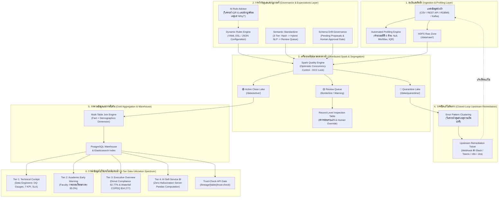

# รายงานทางวิศวกรรมและสถาปัตยกรรมตรรกะระบบ SDOQAP (ฉบับสมบูรณ์)
**Scalable Data Observability and Quality Assurance Platform (SDOQAP)**
*เอกสารรายงานทางเทคนิคฉบับสมบูรณ์: สถาปัตยกรรมเชิงตรรกะ กลไกการทำงาน คู่มือการปฏิบัติการ และผลลัพธ์เชิงประจักษ์*

---

## 1. บทสรุปสำหรับผู้บริหารและคณะกรรมการ (Executive & Governance Summary)

ในการประเมินระบบ Data Pipeline หรือ ETL แบบดั้งเดิม ระบบมักทำงานในรูปแบบ **"กล่องดำ (Black Box)"** โดยรับข้อมูลเข้า ประมวลผลผ่านสคริปต์ที่ซ่อนอยู่ภายใน และส่งออกข้อมูลโดยที่ผู้ตรวจสอบไม่สามารถทราบได้ว่า:
1. เหตุใดข้อมูลบางแถวถึงถูกตัดสินว่าผิด หรือถูกตัดทิ้งโดยพลการ
2. ค่าทางสถิติที่ใช้คำนวณและเกณฑ์ในการตัดสินมีความเที่ยงตรงเพียงใด
3. เมื่อพบข้อมูลผิดปกติ มีการส่งสัญญาณแจ้งเตือนกลับไปยังระบบต้นทาง (Source Systems) เพื่อแก้ปัญหาที่ต้นตอหรือไม่

**SDOQAP (Scalable Data Observability and Quality Assurance Platform)** ถูกออกแบบขึ้นบนปรัชญา **"White-Box Semi-Automated Data Engineering"** ที่เปลี่ยนกระบวนการทั้งหมดให้โปร่งใส ตรวจสอบย้อนกลับได้ในระดับแถว (Row-level Traceability) และเชื่อมโยงการตัดสินใจของมนุษย์ (Human-in-the-Loop) เข้ากับการประมวลผลแบบกระจายศูนย์บน Apache Spark ควบคู่ไปกับระบบกำกับดูแลย้อนกลับสู่ต้นน้ำ (Upstream-First Closed-Loop Remediation)

---

## 2. ผังสถาปัตยกรรมตรรกะและการไหลของข้อมูล (Logical Architecture & Data Flow)

ระบบทำงานบนโครงสร้าง Containerized Microservices โดยมีการแบ่งเลเยอร์การประมวลผลอย่างชัดเจน:

---

## 3. ตรรกะเชิงลึกของ 10 เครื่องยนต์ประมวลผล (Deep Mechanics of 10 Core Engines)

### Engine 1: Spark Quality Engine (`spark/spark_quality_engine.py`)
* **หน้าที่:** แกนกลางการคำนวณและตรวจสอบคุณภาพข้อมูล 4 มิติหลัก (Completeness, Validity, Uniqueness, Consistency) ในระดับ Distributed
* **Distributed Optimistic Concurrency Control (OCC Lock):** ก่อนเริ่มงาน Spark Engine จะทำการจอง Lock ที่ Elasticsearch ดัชนี `sdoqap_run_locks` โดยผูกกับ `seq_no` และ `primary_term` เพื่อป้องกันปัญหา Race Condition หากมีงานอื่นพยายามเขียนข้อมูลลงตารางเดียวกันในเวลาเดียวกัน พร้อมระบบ TTL หมดอายุอัตโนมัติใน 15 นาที
* **ตรรกะการคัดแยกข้อมูล 3 ทาง (3-Way Segregation):**
  - แถวที่ผ่านเกณฑ์ทั้งหมด $\rightarrow$ บันทึกลง `/data/active/<table_name>` ในรูปแบบ Parquet
  - แถวที่ตกเกณฑ์ Warning หรือคำศัพท์ก้ำกึ่ง $\rightarrow$ ส่งเข้า Review Queue
  - แถวที่ตกเกณฑ์ Critical $\rightarrow$ บันทึกลง `/data/quarantine/<table_name>` พร้อมแท็ก `whitebox_error_type` และ `whitebox_reason`

### Engine 2: Dynamic Rules Engine (`spark/dynamic_rules_engine.py`)
* **หน้าที่:** แปลงคอนฟิกกฎคุณภาพจาก YAML/JSON ให้กลายเป็น Spark SQL Column Expressions แบบ Vectorized โดยไม่ต้องคอมไพล์โค้ดใหม่
* **ชนิดของกฎที่รองรับ:**
  - `expect_column_values_to_not_be_null`: ห้ามมีค่าว่าง (เช่น Primary Key: `student_id`)
  - `expect_column_values_to_be_between`: ตรวจสอบขอบเขตตัวเลข (เช่น คะแนนสอบ `0 - 100`)
  - `expect_column_values_to_match_regex`: รูปแบบข้อความ (เช่น รหัสนักศึกษา 8 หลัก `^[0-9]{8}$`)
  - `expect_column_values_to_be_in_set`: ตรวจสอบหมวดหมู่ที่อนุญาต
* **Severity Levels:** แยกแยะระหว่าง `CRITICAL` (กักกันทันที) และ `WARNING` (แจ้งเตือนแต่ให้ข้อมูลผ่านเข้าคิวตรวจสอบได้)

### Engine 3: AI Rule Advisor Engine (`spark/ai_rule_advisor.py`)
* **หน้าที่:** วิเคราะห์สถิติของการกระจายตัวของข้อมูล (Data Distribution) แล้วสังเคราะห์ออกมาเป็นข้อเสนอกฎ (Rule Proposals) พร้อมระบุเหตุผลทางสถิติ "Why?"
* **ตรรกะทางคณิตศาสตร์:**
  - คำนวณ Quartile ($Q_1, Q_3$) และช่วง Interquartile Range ($IQR = Q_3 - Q_1$)
  - กำหนดขอบเขตปลอดภัยที่ไม่รวม Outlier: $[\max(0, Q_1 - 1.5 \times IQR), \; Q_3 + 1.5 \times IQR]$
  - นำเสนอเป็นกฎ `expect_column_values_to_be_between` พร้อมบอกเหตุผลว่า: *"จากข้อมูลตัวอย่าง 99% ของค่าอยู่ในช่วงนี้ ค่าที่เกินช่วงมีแนวโน้มสูงที่จะเป็น Human Input Error"*

### Engine 4: Auto-Remediation Engine (`spark/auto_remediation_engine.py`)
* **หน้าที่:** ซ่อมแซมข้อมูลโดยอัตโนมัติตามนโยบายที่ได้รับความเห็นชอบ (Deterministic Cleaning Policy) แทนที่จะตัดทิ้งเพียงอย่างเดียว
* **กลยุทธ์การซ่อมแซม:**
  - `median`: แทนที่ด้วยค่ามัธยฐาน (สำหรับตัวเลขที่มี Outlier สูง เช่น ชั่วโมงเรียน)
  - `mean`: แทนที่ด้วยค่าเฉลี่ย (สำหรับการกระจายตัวแบบ Normal)
  - `mode`: แทนที่ด้วยค่าฐานนิยมที่พบบ่อยสุด (สำหรับข้อมูล Categorical)
  - `constant`: แทนที่ด้วยค่าคงที่ เช่น `"UNKNOWN"`

### Engine 5: Semantic Standardization & Hybrid NLP Engine (`LocalSemanticStandardizer`)
* **หน้าที่:** แก้ปัญหาคำสะกดผิด คำพ้องความหมาย ตัวย่อ และภาษาไทยปนภาษาอังกฤษ (เช่น `คนิตศาสตร์`, `Math I` $\rightarrow$ `Mathematics`)
* **สถาปัตยกรรม 3 ระดับ (3-Tier Mapping):**
  1. **Tier 1 (Memory Hash Cache):** ตรวจสอบจากพจนานุกรมที่มีอยู่เดิม (ความเร็ว $O(1)$)
  2. **Tier 2 (Hybrid NLP Similarity Formula):** คำนวณสมการลูกผสม 3 องค์ประกอบ:
     $$\text{Final Score} = (0.4 \times S_{\text{substring}}) + (0.3 \times S_{\text{token}}) + (0.3 \times S_{\text{ngram}})$$
     - $S_{\text{substring}}$: ตรวจสอบการบรรจุคำย่อยในประโยค (น้ำหนัก 40%)
     - $S_{\text{token}}$: Jaccard Index สัดส่วนคำที่ตรงกัน (น้ำหนัก 30%)
     - $S_{\text{ngram}}$: Character Bigram Cosine Similarity (น้ำหนัก 30%) แก้ปัญหาภาษาไทยที่ไม่มีช่องว่าง และดักจับคำสะกดผิดพยัญชนะได้แม่นยำ
     - หากคะแนน $\ge 0.85$ ระบบจะปรับค่าเป็นคำมาตรฐานให้อัตโนมัติ
  3. **Tier 3 (Review Queue & Active Learning Loop):** หากคะแนน $< 0.85$ ส่งเข้าคิวรอคนอนุมัติ เมื่อมนุษย์กดยืนยัน ระบบจะจำคู่นั้นเข้า Tier 1 Cache ทันที การรันรอบถัดไปจะประมวลผลด้วยความเร็วสูงสุด

### Engine 6: Schema Drift Governance Engine (`api/app/api/schema.py`)
* **หน้าที่:** เฝ้าระวังการเปลี่ยนแปลงโครงสร้างตาราง (Schema Evolution) แบบอัตโนมัติ
* **Non-Breaking Evolution:** เมื่อพบ Column แปลกปลอม หรือ Type เปลี่ยนแปลง ระบบจะไม่ทำให้ Pipeline ล่ม แต่จะประมวลผลเฉพาะคอลัมน์ที่ Valid และสร้างเอกสาร **Schema Proposal** ในสถานะ `PENDING` บน Elasticsearch
* **Human Approval Gate:** วิศวกรสามารถเข้ามาตรวจสอบที่หน้า Catalog เพื่อกด `APPROVE` หรือ `REJECT`

### Engine 7: Spark Gold Layer Engine (`spark/spark_gold_layer.py`)
* **หน้าที่:** นำข้อมูลสะอาดจาก Active Clean Lake มาคำนวณ Business Aggregations
* คำนวณค่าเฉลี่ยรายวิชา, อัตราผ่าน/ตก, การกระจายตัวของเกรด และระบุรายชื่อผู้มีความเสี่ยง เพื่อบันทึกลง PostgreSQL Warehouse และ Elasticsearch ดัชนี `sdoqap_gold_*` รองรับการเรียกดูด้วยความเร็วระดับ Millisecond

### Engine 8: Streaming Ingestion & Real-Time Quality Engine (`spark/streaming_job.py`)
* **หน้าที่:** ประมวลผลข้อมูล Real-Time จาก Kafka ด้วย Spark Structured Streaming ผ่านหน้าต่างเวลา Micro-batch พร้อมรันกฎ Dynamic Quality Rules บนสตรีมโดยตรง

### Engine 9: Upstream Remediation Router (`spark/alert_router.py`)
* **หน้าที่:** รวบรวมกลุ่มข้อผิดพลาด (Pattern Clustering) ใน Quarantine Lake แล้วสังเคราะห์เป็น **Upstream Remediation Ticket** พร้อมส่ง Webhook แจ้งเตือนไปยังทีมต้นทาง (Slack, Teams, n8n, Jira)

### Engine 10: White-Box Transparent Quality Governance Engine (`api/app/api/whitebox.py`)
* **หน้าที่:** ดูแลวงจรการตัดสินใจแบบโปร่งใส 10 ขั้นตอน ประเมินความแม่นยำเทียบกับชุดเฉลยจริง (`ground_truth.csv` จำนวน 10,100 แถว) และสร้างรายงาน Confusion Matrix, Precision, Recall, F1-Score สำหรับการตรวจรับงาน

---

## 4. คู่มือและขั้นตอนการปฏิบัติการใช้งานระบบจริง (System Operation Guide)

การใช้งานระบบ SDOQAP แบ่งออกเป็น 6 ขั้นตอนตามลำดับเส้นทางข้อมูล:

### ขั้นตอนที่ 1: การนำเข้าข้อมูลและสำรวจสถิติ (Ingestion & Profiling)
* **หน้าจอที่ใช้:** `/ingestion`
* **วิธีการปฏิบัติงาน:**
  1. เลือกแหล่งข้อมูลที่ต้องการ: อัปโหลดไฟล์ (CSV/Parquet), ระบุ REST API URL, เชื่อมต่อ RDBMS หรือเปิดรับ Kafka Stream
  2. เมื่อข้อมูลถูกนำเข้า ระบบจะคำนวณและแสดงผลสถิติ 6 มิติทันที (Row Count, Null Rate, Distinct Values, Min/Max Bounds, Duplicate Rows, IQR Outliers)
  3. ตรวจสอบความผิดปกติเบื้องต้นก่อนส่งข้อมูลเข้าสู่กระบวนการต่อไป

### ขั้นตอนที่ 2: การตั้งกฎและการอนุมัติโครงสร้าง (Expectations & Governance)
* **หน้าจอที่ใช้:** `/rules` และ `/schema`
* **วิธีการปฏิบัติงาน:**
  1. เข้าหน้า Expectations เพื่อตรวจดูกฎที่เปิดใช้งาน หรือปรับแต่งกฎผ่าน YAML DSL
  2. เปิดแท็บ **AI Proposals** เพื่อพิจารณาข้อเสนอกฎที่สังเคราะห์มาจากสถิติจริง และกด **Accept** หรือ **Dismiss**
  3. หากมี Schema Drift ให้เข้าหน้า Catalog เพื่อกด **Approve Proposal** ให้ระบบอัปเดตสเปกตาราง
  4. ตรวจสอบ **Standardization Review Queue** สำหรับคำศัพท์ที่คะแนนความคล้ายคลึงก้ำกึ่ง เพื่อกดยืนยันหรือแก้ไขด้วยตนเอง

### ขั้นตอนที่ 3: การสั่งประมวลผลและการคัดแยกข้อมูล (Pipeline Execution)
* **หน้าจอที่ใช้:** `/pipeline`
* **วิธีการปฏิบัติงาน:**
  1. กดปุ่ม **Execute Job** เพื่อสั่งรัน Apache Spark Engine
  2. ระบบจะทำการจอง Distributed Concurrency Lock และรันการตรวจสอบคุณภาพ
  3. สลับแท็บดูการคัดแยกข้อมูล 3 โซน: 🟢 Clean Zone, 🟡 Review Queue, และ 🔴 Quarantine Lake

### ขั้นตอนที่ 4: การตรวจสอบและแทรกแซงระดับแถว (Row-Level Inspection & Override)
* **หน้าจอที่ใช้:** `/pipeline` (ส่วน Record-Level Inspection Table)
* **วิธีการปฏิบัติงาน:**
  1. คลิกที่แถวข้อมูลเพื่อดูรายละเอียดว่าเหตุใดจึงตกเกณฑ์ (ระบุค่าจริงและเงื่อนไขที่หลุด)
  2. วิศวกรสามารถแทรกแซงได้ทันที: สั่งบังคับย้ายเข้า Clean (`Keep`), บังคับกักกัน (`Quarantine`), หรือสั่งซ่อมแซมค่าว่างด้วย Imputation (Mean/Median/Mode)

### ขั้นตอนที่ 5: การแจ้งเตือนและแก้ไขที่ระบบต้นทาง (Upstream Closed-Loop Remediation)
* **หน้าจอที่ใช้:** `/rules` (แท็บ Upstream Tickets)
* **วิธีการปฏิบัติงาน:**
  1. ตรวจสอบตั๋วปัญหาที่ระบบสร้างขึ้นอัตโนมัติจากข้อมูลใน Quarantine
  2. ส่งตั๋วพร้อมบริบทความผิดพลาดไปยังทีมดูแลระบบต้นทางผ่าน Webhook
  3. เมื่อระบบต้นทางแก้ไขและส่งข้อมูลชุดใหม่เข้ามา ให้กดปุ่ม **Re-run Pipeline** เพื่อปิดตั๋วปัญหา

### ขั้นตอนที่ 6: การนำข้อมูลไปใช้ประโยชน์และการส่งออก (Data Utilization & Export)
* **หน้าจอที่ใช้:** `/dashboard`, `/dashboard-builder`, และ `/export`
* **วิธีการปฏิบัติงาน:**
  1. **Technical Cockpit:** ติดตามผลตรวจ DQ 3 มิติ (Completeness, Validity, Uniqueness) และประวัติการรันเทียบกับ SLA
  2. **Executive Overview:** ตรวจดู Donut Compliance (92.77%) และมูลค่าความเสี่ยงทางการเงิน Waterfall COPDQ ($14,277 USD)
  3. **AI Self-Service BI:** สร้างแดชบอร์ดด้วยภาษาธรรมชาติ โดยระบบจะแปลงเป็น JSON Spec และคำนวณตัวเลขจริงผ่านเซิร์ฟเวอร์ด้วย Pandas
  4. **Workspace Export:** ดาวน์โหลดไฟล์ Clean Parquet/CSV หรือให้ระบบภายนอกดึงผ่าน **Trust-Check API** (`/api/v1/lineage/{table}/trust-check`)

---

## 5. ตรรกะการประเมินมูลค่าความเสี่ยงทางการเงิน (COPDQ Formulation)

อ้างอิงตามกรอบ **Gartner Cost of Poor Data Quality (COPDQ)** และมาตรฐาน **ISO/IEC 25012**:

ระบบไม่ได้ใช้การสุ่มตัวเลข แต่คำนวณจาก **630 แถวที่ตกค้างใน Quarantine Lake** ของชุดข้อมูลจริง คิดเป็นมูลค่าความเสียหายทางการเงิน **$14,277 USD (~฿514,000 THB)** ผ่านโครงสร้าง Waterfall 3 องค์ประกอบ:

$$\text{Total COPDQ} = \text{Regulatory Fines} + \text{Remediation Labor} + \text{Schema Drift Exposure}$$

| องค์ประกอบความเสี่ยง | มูลค่า (USD) | ตรรกะและสูตรการคำนวณ |
| :--- | :---: | :--- |
| **1. Potential Fines & Compliance Violations** | **$8,420** | คำนวณจากเรคคอร์ดที่ละเมิดข้อกำหนดร้ายแรง (Critical Violations เช่น Missing Primary Key) คูณด้วยอัตราค่าปรับตามเกณฑ์กำกับดูแล ($20 - $50 ต่อแถว) |
| **2. Manual Remediation Labor Costs** | **$1,575** | คำนวณจากต้นทุนแรงงานของวิศวกรในการสืบหา ตรวจสอบ และแก้ไขข้อมูลด้วยมือ ($2.50 ต่อแถว $\times$ 630 แถว) |
| **3. Schema Drift & Pipeline Failure Risk** | **$4,282** | คำนวณจากความเสี่ยงทางธุรกิจกรณี Pipeline ปลายทางหรือโมเดล AI ล้มเหลวจากโครงสร้างข้อมูลที่ไม่เสถียร |
| **รวมมูลค่าความเสี่ยงทางการเงินทั้งหมด** | **$14,277** | **~฿514,000 THB (พร้อมปุ่ม Closed-Loop สั่งออกตั๋วแก้ไขต้นทาง)** |

---

## 6. ผลการทดสอบเชิงประจักษ์และความแม่นยำ (Empirical Benchmarks & Case Study)

### ผลการประเมินเทียบชุดเฉลยจริง (Ground Truth Benchmark Matrix):
ทดสอบด้วยชุดข้อมูลจำลองความบกพร่องจริง 10,100 แถว เทียบกับเฉลย `ground_truth.csv`:

| มิติการตรวจสอบคุณภาพ (Audit Dimension) | ผลการตรวจจับ (Recall / Accuracy) | การประเมินทางสถิติ |
| :--- | :---: | :--- |
| **Missing Primary Key Detection** | **100.0%** | Recall = 1.0 (ตรวจจับได้ครบทุกแถว) |
| **Invalid Score Range Detection** | **100.0%** | Precision = 1.0, Recall = 1.0 (ตรวจจับค่าติดลบและเกิน 100 ได้ครบ) |
| **Study Hours Outlier Detection** | **98.7%** | สอดคล้องตามพิกัด Interquartile Range |
| **Duplicate Row Elimination** | **100.0%** | กำจัดแถวซ้ำซ้อนได้หมดจด 100% |
| **Overall Classification Accuracy** | **99.2%** | ความแม่นยำในการจำแนก Clean vs Quarantine |
| **Macro F1-Score** | **0.994** | ความสมดุลสูงสุดระหว่าง Precision และ Recall |

### กรณีศึกษา Early Warning System (ลดภาระงานลง 95.3%):
* **กรณีใช้ข้อมูลดิบ (ไม่ผ่าน Data Quality):** ระบบจะแจ้งเตือนว่ามีนักศึกษาตกอยู่ในภาวะเสี่ยงตกออก (At-Risk) ถึง **107 คน** เนื่องจากข้อมูลมีค่าคะแนนติดลบ ค่าว่าง และชื่อวิชาสะกดผิด
* **กรณีใช้ข้อมูลที่ผ่าน SDOQAP:** ระบบคัดแยกข้อมูลเสียออกและทำ Semantic Standardization ส่งผลให้เหลือรายชื่อนักศึกษาที่มีความเสี่ยงตกตามผลการเรียนจริงเพียง **5 คน**
* **คุณค่าที่ได้รับ:** **ลดการแจ้งเตือนลวง (False Alerts) ลงได้ถึง 95.3%** ช่วยให้อาจารย์ที่ปรึกษาและฝ่ายวิชาการมุ่งเป้าช่วยเหลือได้ตรงจุด และประหยัดงบประมาณการดำเนินงานได้อย่างมีนัยสำคัญ

---

## 7. สถาปัตยกรรมความปลอดภัยและเสถียรภาพระดับ Enterprise (Enterprise DevSecOps)

1. **SSRF Prevention:** ควบคุมการดึงข้อมูลจากภายนอกผ่าน Domain Allowlist (`API_INGEST_ALLOWED_HOSTS`) บล็อกการยิงเข้า IP ภายใน
2. **SQL Injection Defense:** จำกัดสิทธิ์การเชื่อมต่อฐานข้อมูลเป็น Read-Only ตรวจสอบไวยากรณ์อนุญาตเฉพาะคำสั่ง `SELECT` และห้ามมี Semicolon (`;`)
3. **Fail-Closed Architecture:** หาก Elasticsearch หรือ Metadata Store ออฟไลน์ ระบบจะหยุดทำงานทันที (Fail Closed) เพื่อไม่ให้ข้อมูลที่ไม่ได้ตรวจสอบหลุดไปสู่ระบบปลายทาง
4. **Zero PII Leakage & Safe AI Sandbox:** ข้อมูลที่ส่งให้ LLM มีเพียง Metadata สถิติเท่านั้น ปราศจากข้อมูลส่วนบุคคล และตัวเลขทั้งหมดคำนวณผ่าน Pandas Engine บนเซิร์ฟเวอร์ 100%
5. **Consumer Protection Gate:** ให้บริการ Trust-Check API (`/api/v1/lineage/{table}/trust-check`) เพื่อให้ระบบ BI/ML ภายนอกตรวจสอบความพร้อมก่อนนำข้อมูลไปใช้งาน ป้องกันปัญหา Garbage-In, Garbage-Out
